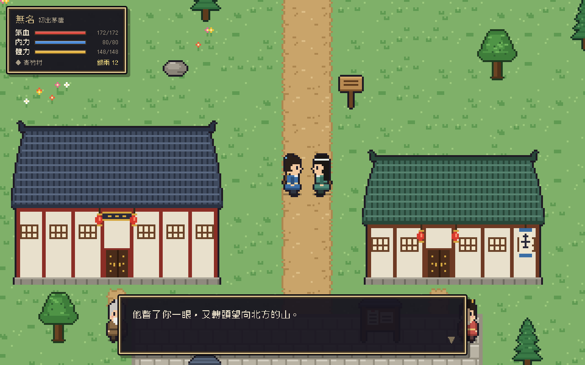
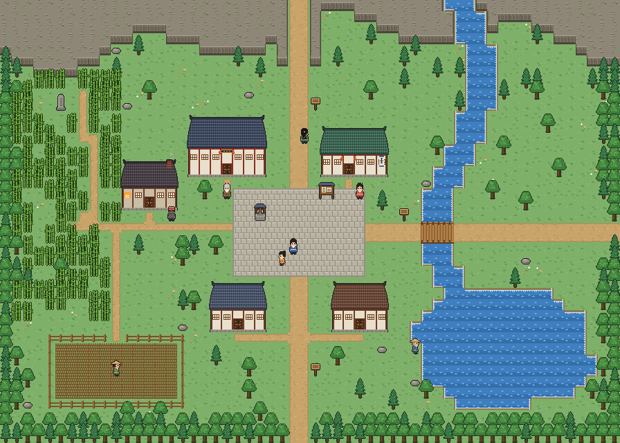

# 扶搖江湖 — 像素武俠 RPG

一款致敬掌機時代日式 RPG 的**像素風武俠遊戲**，在瀏覽器上執行。
目標是高自由度：在江湖裡四處遊歷、接支線、練武功、交朋友、結恩怨。世界觀、人物、門派與武功皆為原創。



## 目前進度

- **地圖**：江南一帶。臨江縣有青竹村（含村北）、蒼嵐山（斷崖寨）、雲水渡口、臨江城（城南、城北）、鳴泉山（鳴泉劍派院落與後山），各建築有室內；江南大地圖（東海、大江、碧漪湖、群山），據點之間一律走大地圖；雲水渡口靠船家擺渡過河，西岸有茶棚給旅人歇腳；大江入海口的港口大埠頭（海鮮料理、魚市、海商、船行水路、海神祠求籤、觀潮台）；碧漪湖西岸的漁村（棧橋、蘆葦蕩、荷塘、湖鮮館、湖心島望月亭）；長路中途有驛站、茶亭可以歇腳過夜；走大地圖時路上偶爾碰上小事：行商擺攤、扶崴腳的老人、撿到包袱、旅人說傳聞、日出晚霞、雨天躲廟、官道盤查、遊俠甘十一找你切磋
- **成長**：沒有人物等級。建立角色時擲五維（勁力、身法、根骨、內息、悟性），靠武功的重數、悟招與突破成長
- **戰鬥**：回合制與半即時制、自動戰鬥、戰鬥狀態（格擋、震懾、破綻…）、頭目會蓄勢放殺招
- **支線**：蒼嵐山賊、小虎的木劍，以及鳴泉劍派的委託
- **人際**：熟悉度與名聲，交談、切磋、贈禮、請教、交易，每個人認識你的方式不同；聊天時對方偶爾會問你問題，答得好交情長得快
- **房產**：買空地蓋房、擴建五級、家具與擺設風格
- **門派（鳴泉劍派）**：入門考驗與拜師、晨課與練樁、同門過招、書房研讀與抄錄武功、任務榜（雜務、下山委託）、
  繳納、月例、弟子名冊、正式弟子考核、三位長老的真傳拜師試煉、離開師門；做雜務也能順便練輕功、外功、學識或烹飪
- **兵器**：劍、刀，品級越高攻擊越高；劍法要拿劍、刀法要拿刀、拳掌空手，拿錯只有九成威力；石家鐵鋪、趕集、當鋪買得到，鳴泉劍派依身分發佩劍
- **服飾**：帽子、上衣、褲子、鞋子、手上與頸上飾品，品級從粗製到極品，加防禦與閃避；臨江城錦繡布莊買衣服，鳴泉劍派依身分發弟子服
- **學識**：在鳴泉書房讀三字經、論語、孫子兵法等經史子集，學識高了買東西便宜、研讀武功也領悟得多
- **琴棋書畫**：聽泉亭撫琴、聽劍亭打譜、書案練字、望江台寫生；跟有同好的人論琴、對弈、品字、賞畫
- **節慶**：過年拜年領紅包、元宵猜燈謎、清明祭掃劍塚、端午比劍、中元放河燈、中秋賞月、掌門壽辰拜壽、冬至吃湯圓、除夕吃年夜飯，還有各節的點心與燈籠；節慶跟著季節走：年節家家貼春聯、福字，臨江城擺年貨攤（鞭炮、紅燈籠、年糕），除夕、過年、元宵夜裡放煙火；端午門上插艾草、江上賽龍舟（可以下注，也能上船划），元宵夜城南廣場燈會猜燈謎，中元碼頭放河燈，中秋望江樓賞月宴；節慶當天遇到熟人會互道佳節，過年交情好的還會塞紅包；店裡的生意在節慶也比較好
- **紡織與馬**：在錦繡布莊學紡織、織出粗製到極品的衣物；跟梁老四買馬，騎著在室外走得更快
- **烹飪**：鳴泉廚房每天發一份飯；跟伙房師傅學菜、買食材，在大灶或家裡的灶台做飯品、麵品、湯品、甜品共 16 道菜，有熟練度與品質（普通、上品、精品）
- **四季**：春夏秋冬與二十四節氣，交節氣那天提要多一句；秋天草地枯黃、樹轉紅葉，冬天下雪、地面覆雪、樹梢積雪；魚、荷塘、藥圃、野菌、山路與路上的小事都跟著季節變
- **時間**：從二月初一開始，HUD 顯示日期、節慶與節氣；一刻 15 分鐘，做事才花時間；日夜變化、天氣（晴、陰、雨、霧）；NPC 白天出門、天黑回房；練功花體力，累了要睡覺或小睡
- **選單**：按 X／Esc 打開一本書，上緣有八條書籤（人物、武功、技能、行囊、門派、交遊、江湖事、系統），←→ 翻頁時有翻頁動畫；每頁左右兩面是概覽，選中一項按 E 會攤開一張摺好的紙，細節與動作（穿脫裝備、修練突破、使用物品、名冊……）都在紙上
- **人物**：名帖上有畫像、氣血內力體力與五維；另一面是人形，頭、頸、身、手、腿、腳與兵器旁各有一個裝備框，穿戴的東西直接畫在框裡，腳下是坐騎；行囊 36 格，每格疊 99 個
- **技能**：烹飪、紡織、學識、琴棋書畫各一個圖示，角上標等級；攤開後一格一格是學會的菜、讀過的書、會織的樣式、手邊的畫（沒學的變暗），看介紹、食材圖示、效果與熟練度
- **門派裡的人自己過日子**：鳴泉劍派的同門每個時辰各有各的事——卯時到辰時排成兩排跟大師兄做晨課（有人會睡過頭）、午時酉時到廚房吃飯、其他時間練樁、練劍、讀書、打坐、挑水、整理菜圃，或兩兩站在一起聊天；下雨就擠進練功房、書房、大通鋪；換事情時會自己走過去，頭上不時冒出小圖示，找正在練功的人說話，他會先停下來；可以跟他們一起練樁、練劍、打坐（收穫多一成、交情也長），跟練劍的人對練一場，或湊到兩個聊天的人旁邊聽八卦；同門之間也有交情（較勁的會吵架、要好的常湊一起），會自己練功變強、升正式弟子、下山歷練；每逢旬休有比武小會排名次，初五、十五、廿五韓長老講武，每晚輪人守夜（輪到你就去敲更鼓）；門派位階分記名、正式、內門、真傳四級，內門弟子能在每年正月十六的年會上（同門都到大殿排班站好）投票、競選執事（新人第一年不容易選上，要靠交情與資歷），過了授徒考驗還能收徒弟、天天指點；門派裡每個人都有年齡、會老，長老年邁會退位，掌門老了會從真傳弟子裡挑人傳位——你也可能接任掌門；當上執事、長老各有每天的差事（下山採買、巡山排夜班、主持比武與祭祖、主講講武、調解吵架、看診），當了掌門就在大殿正中的座位任免職位、定門派方針、主持年會；門派有自己的公庫：後山往東的山田有茶園、水田、藥圃，管山田的甘伯禾春天帶著師弟們採明前茶，茶葉由韋季安下山賣掉，加上山下祖田的田租、香火與委託，養活一門上下的月例與伙食；你可以幫忙採茶、下田、照料藥圃，或捐銀給公庫，內門弟子起在選單裡看得到公庫的月帳，公庫見底時月例只發一半；門派在山下也有產業：臨江城城北的泉霧茶莊由外門管事梁敬亭掌櫃，零賣山上的茶（本門弟子買茶八折，也能幫忙站櫃台），青竹村西南的大田是鳴泉祖田，佃給阿牛他們種；當上外務執事，要把製茶房的茶送進城，夏租、冬租到期時下山找柳村長收租——年成不好時佃戶會求減租，照收還是減免由你決定；門派也有自己的產業：山田往南的南嶺有伐木場與採石場（工頭帶著輪值的師弟們幹活，你也能一起伐木、採石練外功），木料、石料先拿來修繕，多的連同藥材送下山賣；當了掌門可以營造或拆掉產業、擴建茶園與藥圃、收起或重開茶莊、調整月例與用度（節儉或開源），也能支用公款——但長老遲早會查到；產業會碰上山林失火、採石場塌方、茶價起落、地痞到茶莊鬧事、藥圃蟲害這些事，等你去處理
- **城裡、漁村、港口的人自己過日子**：臨江城的糖人攤辰時開張、酉時收攤，乞丐何六上午在城南討飯、下午守在望江樓門口、夜裡縮在牆角睡；大嬸們一早到井邊打水洗衣、旬休趕集時圍在攤子前挑貨，老人家上茶樓聽書、在樹下下棋（可以陪曲老爹下一盤）；碧漪湖的秦老漢卯時出船、午後補網、傍晚在棧橋釣魚，喬小荷上午採蓮；大埠頭的龐老大天沒亮就出海、譚大力在碼頭扛貨、梅小貝跟奶奶上香；起點青竹村也一樣：鍾嬸白天在門口擺茶攤、石岳上午打鐵午後招呼客人、阿牛從早到晚在田裡、王嫂一早到井邊洗衣、陶四旬休進城補貨、柳村長午後巡田；下雨天街上冷清、茶樓熱鬧；兩個人站著聊天時可以湊過去聽街坊的傳聞
- **日常**：每天醒來（或讀檔）先看一頁早晨提要：日期、天氣、節慶、今天該做的事（晨課、雜務、領飯、月例、藥圃）與進行中的任務；選單「江湖事」也有「今日」清單；走到練樁、書架等地方，主角頭上會冒出雲朵泡泡寫出要花的時間與體力，天黑、體力見底、晨課快結束時也會自言自語提醒；練樁、打坐、讀書、織布等可以一次連做幾回；在門派的床鋪排「日課表」，一鍵照表過一天（晨課、領飯、雜務、練樁、研讀、打坐、睡覺），做事或聊天時偶爾會碰上小事（搶收曬藥、撿到同門的劍穗、夜裡後山的劍聲、被拉去偷吃桂花糕……），依時辰、天氣與交情而不同；午時、酉時同門聚到廚房吃飯，同桌聊天交情長得快；茶几、書架、罈子、花叢、石頭偶爾藏著東西，每天換地方；天氣會影響玩法（雨天野獸少、野菌多、室外練功更累，霧天後山有奇遇，晴天曬藥織布更順手）；卜大勺、鍾嬸、魏錦娘不定期下訂單，交菜、交織品換銀兩、材料與交情；每月初十、二十、三十是旬休，門派不上晨課，臨江城趕集，有平時買不到的食材、上品絲線、舊秘笈與護具
- **釣魚與碧漪湖**：跟秦老漢買釣竿，在棧橋、蘆葦蕩、湖心島釣魚；可以自己拉竿（浮標一沉，看準指針落在紅區按 E，正中金心更好），也可以慢慢等、一次連釣幾回；八種湖魚依時辰、天氣、手藝出沒，記進「技能」頁的魚譜；跟喬嫂學糖醋鯉魚、清蒸鱖魚等八道湖鮮；荷塘每天採蓮藕、菱角；傳說每月十五夜裡，白鯉會浮上湖心島的望月亭邊
- **生活串接**：紡織結漁網讓釣魚收穫更多；自家院子的晾魚架把鮮魚曬成魚乾；大宅池塘也能釣；望江樓的汪福來下單收魚、魚乾、蓮藕菱角與湖鮮菜
- **官府與公告欄**：臨江縣衙是一座朱紅院牆圍起的院子（門口石獅、鳴冤鼓），進門是中庭，正北大堂由知縣升堂，西廂簽押房找師爺，東廂捕快房找捕頭領懸賞，東北角的縣牢有獄卒守著；縣衙與街上的公告欄分「重要大事」「懸賞公告」（懸賞，按 E 揭榜）「日常公告」（房屋出售、老店轉讓，有期限）
- **房產與經營**：第一次買下店面就得到稱號「東家」，並翻開一本《經營手冊》（之後隨時能從選單「系統」翻閱），一章一章說明怎麼經營；城裡的民居、店面有人想賣就貼出告示，到縣衙找師爺或城北萬通牙行的牙人錢六買下——可以自己談價（談崩了屋主會漲價），也可以花佣金請牙人出面；民居能出租、修繕，不要了可以市價慢慢賣或降價快賣；店面能開飯館、布莊、魚鋪或雜貨鋪，雇夥計顧店、每天半夜自動結算，東家偶爾也能站櫃台親自招呼客人；城裡的老店偶爾轉讓，買下照舊經營、每旬分紅；店裡櫃台有一本「經營管理」帳簿：總覽盈虧、每日與每月的長條圖、夥計的士氣與加薪（可設年度加薪、發紅包）、自己供貨（自己做的菜、釣的魚、織的衣服）或批貨、從縣衙、金刀鏢局或漕幫請保鏢坐鎮（價錢與本事各不同）；批貨要跟供應商簽合約：去過的地方才知道有哪些供應商（臨江城的牙行、布莊、藥舖，青竹村的菜農，碧漪湖的魚簍，大埠頭的漁船與海商），要親自上門談，簽得越久越便宜，遠的產地價低但要運費、常延誤；在當地有同一種店就由分號就地採辦；店多了可以請掌櫃、大掌櫃（牙行介紹或從夥計提拔）代管，他們照你在「總號帳簿」定的方針處理大小事、把錢交回帳房，不必你事事回去——但忠誠低的會中飽私囊，要記得查帳；店裡和租出去的房子偶爾出事要東家處理（還有夜裡遭小偷）：夥計想加薪或偷懶、地痞上門收保護費（給錢、動手或報官）、大戶人家下訂、老饕上門試菜，租客屋頂漏雨、手頭緊交不出租或送吃的來
- **支線「雲水渡口造橋」**：幫茶棚的季秋娘張羅蓋橋——自己捐錢、找村長與鄉親化緣、到村北採石場鑿青石條、請石匠魯一鑿出馬；三天後河上真的多了一座橋，立起刻著你名字的捐建碑，從此不用再等船
- **臨江城**：分城南（商街、碼頭）與城北（民居、臨江書院），兩區相連；店家、官府門上有匾額與幌子，一眼看得出是什麼店；客棧住店、聽傳聞，望江樓點菜、聽說書，回春堂買藥看傷，當鋪典當與死當貨，金刀鏢局護鏢，縣衙懸賞，漕幫扛貨、擲骰子
- **存檔**：即時存檔、自動存檔、十欄手動存檔（選欄位後確認才存，讀檔也會確認）

<details>
<summary>青竹村全景</summary>



</details>

## 操作

| 按鍵 | 功能 |
| --- | --- |
| 方向鍵 / WASD | 移動 |
| Shift（按住） | 奔跑 |
| E / Space / Enter | 對話、查看、下一句 |
| F / G / R / T / H | 面對人物時：切磋、贈禮、請教、交易、雅趣（論琴、對弈等；熟了才會出現） |
| X / Esc | 開關選單 |
| Ctrl/⌘ + S、F9 | 即時存檔、讀取即時存檔 |
| Q | 戰鬥中切換自動戰鬥 |

## 開始

需要 Node.js 18 以上。

```bash
npm install
npm run dev        # http://localhost:5180
```

其他指令：

```bash
npm run typecheck  # 型別檢查
npm run build      # 打包到 dist/
```

開發小技巧：網址加上 `?zoom=1` 可以縮小看到整張地圖；`?map=mq_sect&at=22,22` 直接從指定地圖與位置開始（其他參數見 [CLAUDE.md](CLAUDE.md)）。

## Godot 版（評估中）

正在評估改用 Godot 4 重做畫面：低多邊形、卡通描邊、2.5D 固定俯角。試作品在 `godot/`，有青竹村（跟村民說話、跟陶四和鍾嬸買賣；可以走進竹風茶寮，屋裡只立著背對鏡頭的兩道牆）、三種六角格戰場（平地、河湖、山道）、時辰與下雨。

- 執行：裝好 Godot 4（免費），用編輯器匯入 `godot/project.godot` 後按 F5，或在終端機跑 `/Applications/Godot.app/Contents/MacOS/Godot --path godot`。
- 操作：方向鍵或 WASD 走路、Shift 跑、空白鍵交談與確認（E 鍵留給之後別種互動）、Q／R 轉鏡頭（每次 90 度，永遠斜 45 度看）、滾輪或 Z／X 拉遠近、T 換時辰、Y 下雨、Tab 換場景；戰鬥用滑鼠點。
- 網頁版的資料改了以後，跑 `npm run godot:data` 重新匯出給 Godot。

## 技術

- **Godot 4**（評估中的新版本）：低多邊形 3D、卡通描邊（`godot/`）
- **Phaser 3**：地圖、人物與動畫
- **React 18**：所有文字介面（對話框、選單、狀態列）
- **Zustand**：遊戲與介面之間的共用狀態
- **Vite + TypeScript**
- 美術素材全部在遊戲啟動時**以程式逐像素繪製**，沒有外部圖檔；瓦片 16px，以整數倍放大保持像素銳利
- 地圖以字元陣列撰寫，方便直接修改（格式見 [`src/game/maps/types.ts`](src/game/maps/types.ts)）

## 專案結構

```
src/
  game/
    art/        程式繪製的地形、人物、建築與物件
    battle/     戰鬥規則、出手順序、招式、敵人、自動戰鬥
    entities/   格子移動的人物
    maps/       地圖資料
    scenes/     Phaser 場景（行走地圖、戰鬥）
    story/      劇情腳本與人物檔案
    character.ts  五維與武功的成長模型、物品、行囊、穿戴
    sect.ts     門派系統
    daily.ts    今日事（早晨提要與「今日」清單）
    thought.ts  主角頭上的想法泡泡（代價與提醒）
    schedule.ts 日課表（能排的事、有人找、偶發小事）
    world/      大地圖的地理、節點與道路
    time.ts     時間、日夜、天氣、NPC 作息、曆法與節慶
    crafts.ts   生活技能（烹飪 cooking、紡織 weaving、學識 books、琴棋書畫 arts）
    gear.ts     服飾部位與品級
    festival.ts 節令點心與節慶擺設
    mounts.ts   坐騎
  ui/           React 介面元件
  state/        共用狀態
```

完整的開發計畫與里程碑見 [PLAN.md](PLAN.md)。

## 授權

介面字型為 [俐方體 11 號（Cubic 11）](https://github.com/ACh-K/Cubic-11)，採 SIL Open Font License 授權，授權條款見 [`public/fonts/OFL.txt`](public/fonts/OFL.txt)。
